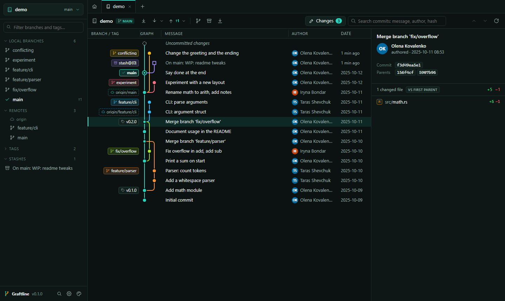

<p align="center"></p>

# Graftline

**English** · [Українська](README.uk.md)

A desktop Git client built around the commit graph. One binary for Windows, macOS and Linux.
The backend is Rust (axum + libgit2); the UI is vanilla JS embedded in the binary. No account, no telemetry.



## Features

- **Commit graph** with branches, remote branches, tags, stashes and HEAD. Search by message, author or hash. Keyboard navigation.
- **Several repositories in tabs.** Open by dialog, from the command line, or drop a folder on the window. The start page lists recent repositories.
- **Sidebar:** local branches with ahead / behind counts, remotes, tags, stashes, submodules, worktrees.
- **Commit panel:** author, message, parents, changed files with line counts.
- **Diff:** unified or side by side, syntax highlighting.
- **Working tree:** stage, unstage and discard a file, a hunk or single lines. Commit and amend.
- **Branches:** create, check out, rename, delete. Drag one branch onto another to merge or rebase.
- **Tags and stashes:** create, delete, push; save, apply, pop, drop.
- **Remotes:** fetch, pull, push with progress and Cancel; clone; add, rename and remove remotes.
- **History:** merge, rebase, interactive rebase (reorder, squash, fixup, reword, drop), cherry-pick, revert, reset.
- **Conflicts:** take a side for a file, a block or a line, or edit the result by hand; continue, skip or abort the operation.
- **File history and blame.**
- **Command palette** (`Ctrl+P`) and keyboard shortcuts (`F1` lists them).
- **Themes:** Graftline Light and Graftline Dark (follows the system by default), Graphite, Paper, One Dark Pro, Dracula, Nord, GitHub Light. The button is at the bottom of the sidebar; a theme previews on hover.
- **Changes made outside the app** (terminal, IDE) appear by themselves. The graph keeps its scroll position.

## Your work is safe

A Git client handles work that is saved nowhere else. These rules are part of the design and have tests.

| Action | What Graftline does |
|---|---|
| Discard files, hunks or lines | Asks first. Saves the files in a snapshot. The notification has **Undo**. |
| `reset --hard` | Asks first, with the number of commits and changed files. Saves the changed files. **Undo** restores both. |
| Abort a merge or rebase | Saves the conflict resolutions made so far. |
| Delete a branch | Lists the commits that exist on no other branch or tag, then asks. **Undo** recreates the branch. |
| Drop a stash, delete a tag | Asks or offers **Undo**. |
| Force push | Always `--force-with-lease`. Asks first and tells how many remote commits are removed. |
| Rebase or amend pushed commits | Asks first and explains what others must do. |
| A Git command fails | Shows the command line and Git's output word for word. |

Snapshots are commits under `refs/graftline/snapshots/` in your repository. They do not appear in the graph. Open the list with the clock button in the changes panel. The newest 50 are kept.

## Install

Builds are on the [Releases](https://github.com/byht1/graftline/releases/latest) page and on the [website](https://byht1.github.io/graftline/#downloads).

| System | File | How to install |
|---|---|---|
| Windows 10/11 | `Graftline-Setup-x64.msi` | Installer: folder, shortcuts, "Open in Graftline" for folders, a page that shows where settings are kept |
| Windows | `graftline.exe` | Portable: one file, no install |
| macOS 11+ | `Graftline-macOS-universal.dmg` | Drag Graftline to Applications. First start: right-click → Open |
| Debian / Ubuntu | `graftline-linux-amd64.deb` | `sudo apt install ./graftline-linux-amd64.deb` |
| Linux (other) | `graftline-linux-x86_64.tar.gz` | Unpack and run `./graftline`. Needs WebKitGTK 4.1 and GTK 3 |

The builds are not code-signed yet. Windows SmartScreen: *More info → Run anyway*. macOS: right-click → *Open*.

### Git

Graftline reads repositories in process, so browsing works on a computer without Git.
Fetch, pull, push, clone, checkout, stash, merge, rebase, cherry-pick, revert and reset run the `git` on your `PATH`.
This way your SSH agent, credential helper, proxy, hooks, commit signing and Git LFS work as they do in the terminal.
Graftline stores no passwords or tokens.

### Updates

The desktop app checks GitHub for a new release on start (turn it off in **Settings**).
The check sends the app version and nothing about your repositories.
An update is downloaded, verified with SHA-256 and installed; the app restarts.

## Use

```
graftline                     # start page
graftline path/to/repository  # open a repository (any folder inside it)
```

| Shortcut | Action |
|---|---|
| `Ctrl+P` | Command palette |
| `Ctrl+O` / `Ctrl+W` / `Ctrl+Tab` | Open a repository / close the tab / next tab |
| `Ctrl+F`, `Enter`, `Shift+Enter` | Search commits, next and previous match |
| `Ctrl+Shift+F` / `L` / `P` | Fetch / pull / push |
| `Ctrl+B`, `Ctrl+Shift+S` | Create a branch, stash |
| `Ctrl+Shift+C` | Show the uncommitted changes |
| `Space`, `Ctrl+Enter` | Stage the focused file, commit |
| `F5`, `Esc`, `F1` | Refresh, close a panel, list of shortcuts |

On macOS use `⌘` in place of `Ctrl`.

## Where settings are stored

| System | Folder |
|---|---|
| Windows | `%APPDATA%\graftline\` |
| macOS | `~/Library/Application Support/graftline/` |
| Linux | `~/.config/graftline/` |

The folder holds `recent.json` (recent repositories), `ui-prefs.json` (theme, tabs, panel sizes), `window.json`, `cache/` (commit lists that make large repositories open faster), `graftline.log` and the `webview/` cache. `--data-dir` or `GRAFTLINE_DATA_DIR` selects another folder.

## Performance

Measured, not estimated. Repository: [git/git](https://github.com/git/git), 86,230 commits
reachable from all refs, 1,018 tags. Machine: Windows 11, 12 logical cores, release build.

| Step | Time |
|---|---|
| First open: read all commits (8 threads), order them, lay out the graph, first page of 200 rows | 0.75 s |
| Later launches (commits come from the disk cache) | 0.27 s |
| Refresh after a change in the repository (commits already in memory) | 0.21 s |
| Search 86,230 commits for a word | 0.02 s |
| Scrolling, 240 frames at 260 px per frame | median 16.5 ms, 95th percentile 22.6 ms |

The first four rows come from `graftline-server --bench <repo>`; the scroll numbers come from the
running UI. Run the benchmark on your own repository to compare.

How it stays fast:

- Commits are read once, on several threads, and cached on disk per repository.
- The graph layout is computed in Rust. The UI receives rows in pages and draws only the
  visible ones on a canvas.
- Lanes that pass a row are not stored. They are rebuilt from snapshots taken every 256
  rows, so memory does not grow with the number of parallel branches.
- No Git operation blocks the interface. Network operations run as background jobs.

## Limits of this version

- A history with hundreds of branches open at the same time (git/git is one) gives a very wide graph. A commit right of the visible graph column is shown as an arrow at the edge; widen the column to see it.
- Commit search covers the first line of the message, the author and the hash, not the message body.
- File history does not follow renames.
- Single lines are selected in the unified diff; the side-by-side diff works on whole hunks.
- An interactive rebase is refused when its range contains merge commits.
- Submodules and worktrees are shown and can be opened; they are not created or updated here.
- Not included: accounts and cloud sync, GitHub / GitLab / Bitbucket integration, AI features, a terminal.

## Build from source

Needs a stable Rust toolchain and a C compiler (libgit2 is built from source). Node.js is not needed.
Linux also needs `libwebkit2gtk-4.1-dev` and `libgtk-3-dev`.

```
cargo run                       # the desktop app
cargo run -- path/to/repo       # open a repository on start
cargo test                      # the tests create their own temporary repositories
cargo run --bin graftline-server -- --port 7878 path/to/repo   # the same UI in a browser, for UI work
```

In a debug build the UI files are read from `static/` on each request: change a file and reload the page.

| Path | Content |
|---|---|
| `src/graph.rs`, `src/history.rs` | Commit loading, ordering, graph layout |
| `src/repo.rs`, `src/worktree.rs`, `src/conflicts.rs`, `src/extras.rs` | Reading and local changes with libgit2 |
| `src/ops.rs`, `src/rewrite.rs`, `src/jobs.rs`, `src/gitcli.rs` | Operations that run the system `git` |
| `src/safety.rs` | Snapshots before destructive actions |
| `src/lib.rs`, `src/session.rs`, `src/watch.rs` | HTTP API, open repositories, file watch |
| `src/bin/desktop.rs` | The native window |
| `static/` | The UI |
| `packaging/`, `.github/workflows/` | Installers, CI, releases |

## License

[MIT](LICENSE).
