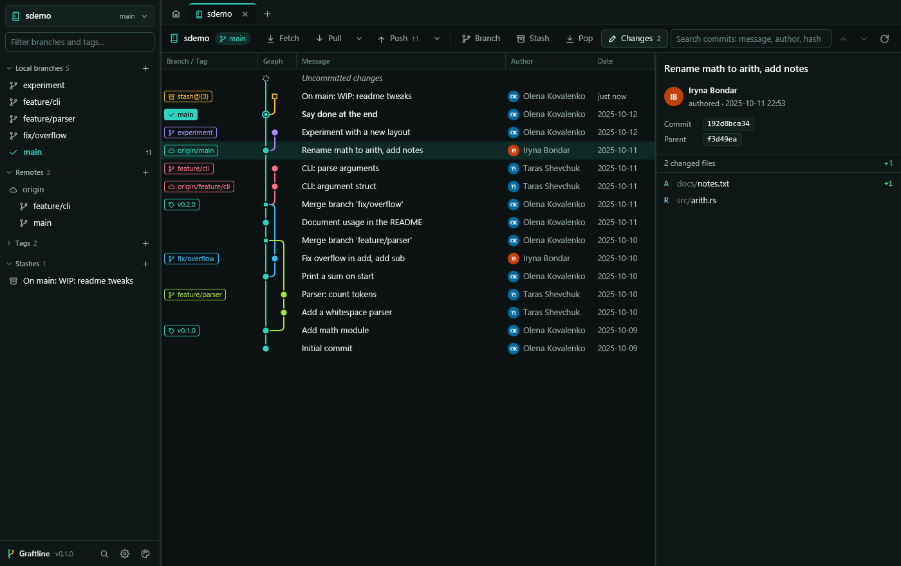

<p align="center"></p>

# Graftline

[English](README.md) · **Українська**

Десктопний Git-клієнт, побудований навколо графа комітів. Один бінарний файл для Windows, macOS і Linux.
Написаний на Rust. Вікно малюється на GPU через [GPUI](https://www.gpui.rs/) — UI-фреймворк редактора Zed; дані Git дає libgit2. Без браузерного рушія, облікових записів і телеметрії.



## Можливості

- **Граф комітів** з гілками, віддаленими гілками, тегами, stash і HEAD. Пошук за повідомленням, автором або хешем. Навігація з клавіатури.
- **Кілька репозиторіїв у вкладках.** Відкриття через діалог, з командного рядка або перетягуванням теки на вікно. Стартова сторінка показує нещодавні репозиторії.
- **Бічна панель:** локальні гілки з лічильниками ahead / behind, remotes, теги, stash, submodules, worktrees.
- **Панель коміту:** автор, повідомлення, батьківські коміти, змінені файли з кількістю рядків.
- **Diff:** unified або side-by-side, з підсвіткою синтаксису.
- **Робоче дерево:** stage, unstage і discard для файлу, hunk або окремих рядків. Commit і amend.
- **Гілки:** створення, checkout, перейменування, видалення. Перетягніть гілку на гілку, щоб зробити merge або rebase.
- **Теги і stash:** створення, видалення, push; save, apply, pop, drop.
- **Remotes:** fetch, pull, push з прогресом і скасуванням; clone; додавання, перейменування і видалення remotes.
- **Історія:** merge, rebase, інтерактивний rebase (reorder, squash, fixup, reword, drop), cherry-pick, revert, reset.
- **Конфлікти:** вибір сторони для файлу, блоку або рядка, ручне редагування результату; продовження, пропуск або скасування операції.
- **Історія файлу і blame.**
- **Термінал** (``Ctrl+` ``): журнал git-команд, виконаних для репозиторію, і рядок для власної git-команди. Журнал ведеться і тоді, коли панель прихована; дія в застосунку ніколи не відкриває панель. Зміну, яку зробила вбудована бібліотека Git, показано як рівнозначну команду з позначкою «built-in». Рядок виконує одну git-команду, а не оболонку: без конвеєрів, перенаправлень, редакторів і запитів пароля. Журнал зберігається до закриття застосунку.
- **Палітра команд** (`Ctrl+P`) і гарячі клавіші (`F1` показує список).
- **Теми:** Graftline Light і Graftline Dark (типово за системною темою), Graphite, Paper, One Dark Pro, Dracula, Nord, GitHub Light. Кнопка розташована внизу бічної панелі; тема показується при наведенні.
- **Зміни, зроблені поза застосунком** (термінал, IDE), з'являються самі. Граф зберігає позицію прокрутки.

## Ваша робота в безпеці

Git-клієнт працює з роботою, яка більше ніде не збережена. Ці правила є частиною архітектури і покриті тестами.

| Дія | Що робить Graftline |
|---|---|
| Discard файлів, hunk або рядків | Спершу питає. Зберігає файли у знімку. Сповіщення має кнопку **Undo**. |
| `reset --hard` | Спершу питає і показує кількість комітів та змінених файлів. Зберігає змінені файли. **Undo** відновлює і коміти, і файли. |
| Скасування merge або rebase | Зберігає вже зроблені розв'язання конфліктів. |
| Видалення гілки | Показує коміти, яких немає в жодній іншій гілці чи тезі, і питає. **Undo** відновлює гілку. |
| Drop stash, видалення тегу | Питає або пропонує **Undo**. |
| Force push | Завжди `--force-with-lease`. Спершу питає і показує, скільки віддалених комітів зникне. |
| Rebase або amend опублікованих комітів | Спершу питає і пояснює, що доведеться зробити іншим. |
| Команда Git завершилась помилкою | Показує командний рядок і вивід Git дослівно. |

Знімки зберігаються як коміти в `refs/graftline/snapshots/` вашого репозиторію. У графі їх не видно. Список відкриває кнопка з годинником у панелі змін. Зберігаються 50 найновіших знімків.

## Встановлення

Збірки розміщені на сторінці [Releases](https://github.com/byht1/graftline/releases/latest) і на [сайті](https://byht1.github.io/graftline/#downloads).

| Система | Файл | Як встановити |
|---|---|---|
| Windows 10/11 | `Graftline-Setup-x64.msi` | Інсталятор: тека, ярлики, пункт «Open in Graftline» для тек, сторінка з місцем зберігання налаштувань |
| Windows | `graftline.exe` | Портативна версія: один файл, без встановлення |
| macOS 11+ | `Graftline-macOS-universal.dmg` | Перетягніть Graftline до Applications. Перший запуск: клацніть правою кнопкою → Open |
| Debian / Ubuntu | `graftline-linux-amd64.deb` | `sudo apt install ./graftline-linux-amd64.deb` |
| Linux (інші) | `graftline-linux-x86_64.tar.gz` | Розпакуйте і запустіть `./graftline`. Потрібен драйвер Vulkan; бібліотеки перелічені у `README.txt` всередині |

Збірки ще не підписані. Windows SmartScreen: *More info → Run anyway*. macOS: клацніть правою кнопкою → *Open*.

### Git

Graftline читає репозиторії всередині процесу, тому перегляд працює і без встановленого Git.
Fetch, pull, push, clone, checkout, stash, merge, rebase, cherry-pick, revert і reset виконує `git` з вашого `PATH`.
Завдяки цьому SSH-агент, credential helper, проксі, hooks, підпис комітів і Git LFS працюють так само, як у терміналі.
Graftline не зберігає паролі й токени.

### Оновлення

Десктопний застосунок під час запуску перевіряє на GitHub, чи є новий реліз (це можна вимкнути в **Settings**).
Перевірка надсилає версію застосунку і нічого про ваші репозиторії.
Оновлення завантажується, перевіряється за SHA-256 і встановлюється; застосунок перезапускається.

## Використання

```
graftline                     # стартова сторінка
graftline path/to/repository  # відкрити репозиторій (будь-яку теку всередині нього)
```

| Клавіші | Дія |
|---|---|
| `Ctrl+P` | Палітра команд |
| `Ctrl+O` / `Ctrl+W` / `Ctrl+Tab` | Відкрити репозиторій / закрити вкладку / наступна вкладка |
| `Ctrl+F`, `Enter`, `Shift+Enter` | Пошук комітів, наступний і попередній збіг |
| `Ctrl+Shift+F` / `L` / `P` | Fetch / pull / push |
| `Ctrl+B`, `Ctrl+Shift+S` | Створити гілку, stash |
| `Ctrl+Shift+C` | Показати незбережені зміни |
| ``Ctrl+` `` | Показати або сховати термінал; `↑` `↓` у ньому повертають ваші команди |
| Подвійний клік, `Ctrl+Enter` | Stage або unstage файлу, commit |
| `Tab` / `Shift+Tab` | Наступне / попереднє текстове поле |
| `F5`, `Esc`, `F1` | Оновити, закрити панель, список клавіш |

На macOS замість `Ctrl` використовуйте `⌘`.

## Де зберігаються налаштування

| Система | Тека |
|---|---|
| Windows | `%APPDATA%\graftline\` |
| macOS | `~/Library/Application Support/graftline/` |
| Linux | `~/.config/graftline/` |

У теці лежать `recent.json` (нещодавні репозиторії), `ui-prefs.json` (тема, вкладки, розміри панелей), `window.json`, `cache/` (списки комітів, які прискорюють відкриття великих репозиторіїв), і `graftline.log`. Іншу теку задає `--data-dir` або `GRAFTLINE_DATA_DIR`.

## Продуктивність

Це виміряні значення, а не оцінка. Репозиторій: [git/git](https://github.com/git/git), 86 230 комітів,
досяжних з усіх refs, 1 018 тегів. Машина: Windows 11, 12 логічних ядер, release-збірка.

| Крок | Час |
|---|---|
| Перше відкриття: читання всіх комітів (8 потоків), впорядкування, розкладка графа, перша сторінка з 200 рядків | 0,40 с |
| Наступні запуски (коміти беруться з дискового кешу) | 0,13 с |
| Оновлення після зміни в репозиторії (коміти вже в пам'яті) | 0,11 с |
| Пошук слова серед 86 230 комітів | 0,01 с |

Рядки дає команда `graftline-bench <repo>` (`cargo run --release --bin graftline-bench -- <repo>`).
Кожне значення — медіана трьох запусків, коли файли репозиторію вже в кеші операційної системи.
Запустіть її на своєму репозиторії для порівняння. Час кадру вікна ще не виміряно.

Чому це працює швидко:

- Коміти читаються один раз, у кілька потоків, і кешуються на диску для кожного репозиторію.
- Розкладка графа рахується один раз для історії. Вікно розміщує і малює на GPU лише видимі рядки.
- Смуги, що проходять крізь рядок, не зберігаються. Вони відновлюються зі знімків, зроблених через кожні 256 рядків, тому пам'ять не росте з кількістю паралельних гілок.
- Жодна операція Git не блокує інтерфейс. Мережеві операції виконуються як фонові завдання.

## Обмеження цієї версії

- Історія із сотнями одночасно відкритих гілок (наприклад, git/git) дає дуже широкий граф. Коміт правіше видимої колонки графа показано стрілкою біля краю; розширте колонку, щоб побачити його.
- Пошук комітів охоплює перший рядок повідомлення, автора і хеш, але не тіло повідомлення.
- Історія файлу не відстежує перейменування.
- Окремі рядки вибираються в unified diff; side-by-side diff працює з цілими hunk.
- Інтерактивний rebase не запускається, якщо діапазон містить коміти злиття.
- Submodules і worktrees показуються і відкриваються; створювати й оновлювати їх тут не можна.
- Файли в панелі змін переводяться у stage мишею (кнопка або подвійний клік); гарячої клавіші для цього ще немає.
- На Linux потрібен драйвер Vulkan. Вікно на Linux і macOS ще не перевірене вручну.
- Не входить: облікові записи і синхронізація в хмарі, інтеграція з GitHub / GitLab / Bitbucket, функції ШІ, термінал.

## Збірка з вихідного коду

Потрібні stable Rust і компілятор C (libgit2 збирається з вихідного коду). Node.js не потрібен.
На Linux також потрібні `libxkbcommon-dev`, `libxkbcommon-x11-dev`, `libwayland-dev`, `libfontconfig1-dev`, `libfreetype6-dev`, `libxcb1-dev`, `libx11-xcb-dev` і `libvulkan-dev`.
На macOS потрібен Xcode (GPUI компілює ним шейдери Metal).

```
cargo run                       # десктопний застосунок
cargo run -- path/to/repo       # відкрити репозиторій під час запуску
cargo test                      # тести самі створюють тимчасові репозиторії
cargo run --release --bin graftline-bench -- path/to/repo      # виміряти час завантаження графа
```

Debug-збірка вміє виконувати команди UI (клавіші, текст, відкриття репозиторію) з файлу, заданого в `GRAFTLINE_UI_DRIVER`; див. `src/ui/driver.rs`.

| Шлях | Вміст |
|---|---|
| `src/graph.rs`, `src/history.rs` | Завантаження комітів, впорядкування, розкладка графа |
| `src/repo.rs`, `src/worktree.rs`, `src/conflicts.rs`, `src/extras.rs` | Читання і локальні зміни через libgit2 |
| `src/ops.rs`, `src/rewrite.rs`, `src/jobs.rs`, `src/gitcli.rs` | Операції, які виконує системний `git` |
| `src/safety.rs` | Знімки перед руйнівними діями |
| `src/lib.rs`, `src/session.rs`, `src/watch.rs` | Стан застосунку, відкриті репозиторії, спостереження за файлами |
| `src/main.rs`, `src/ui/` | Вікно та інтерфейс (GPUI) |
| `assets/ui/themes.css` | Кольори тем |
| `packaging/`, `.github/workflows/` | Інсталятори, CI, релізи |

## Ліцензія

[MIT](LICENSE).
